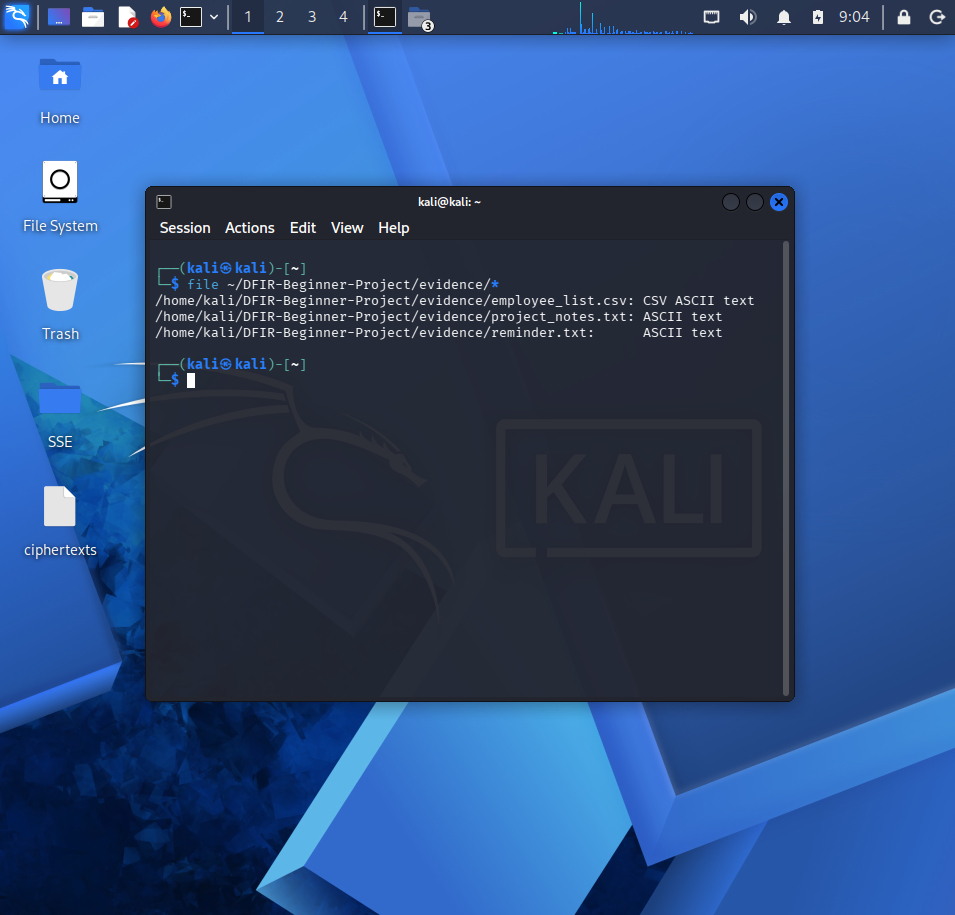
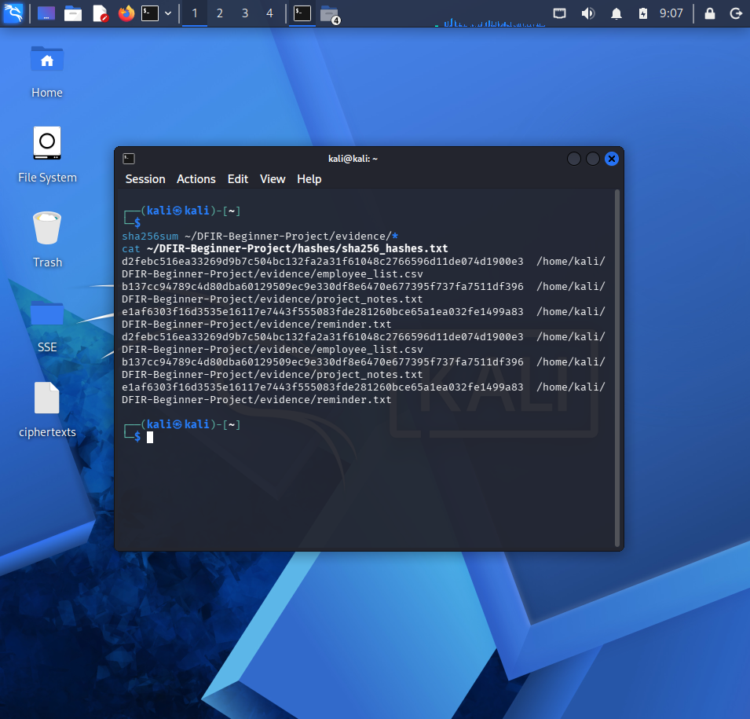
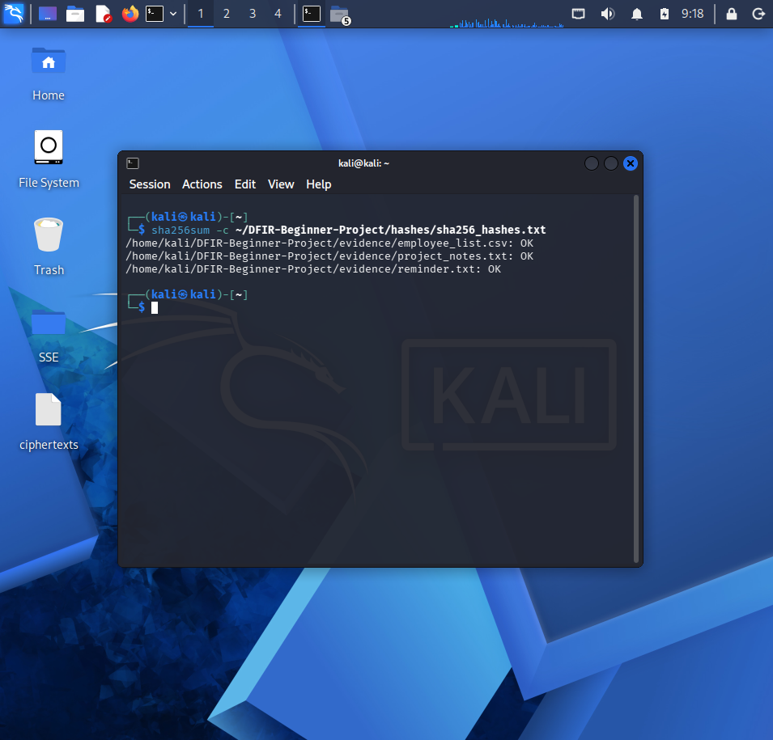
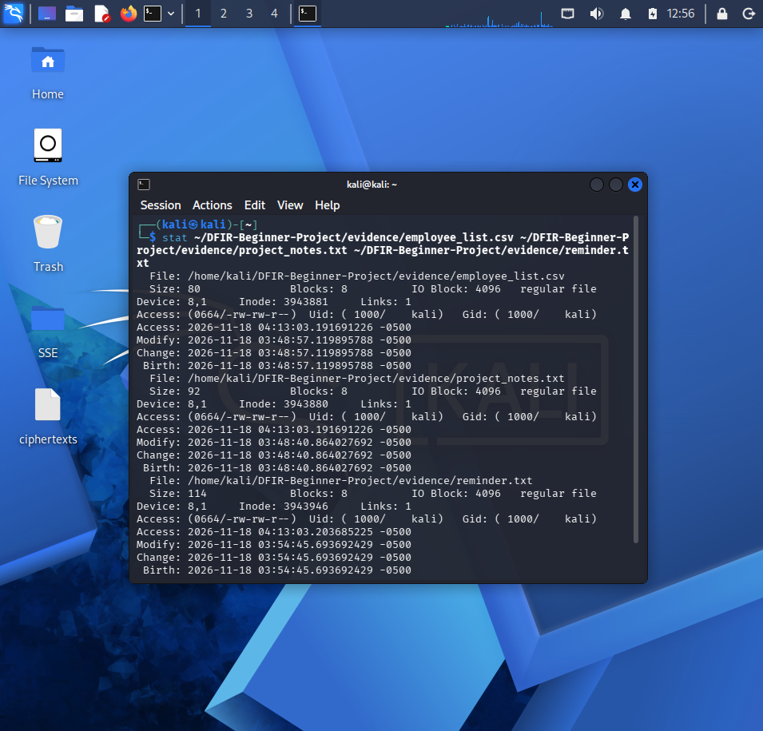
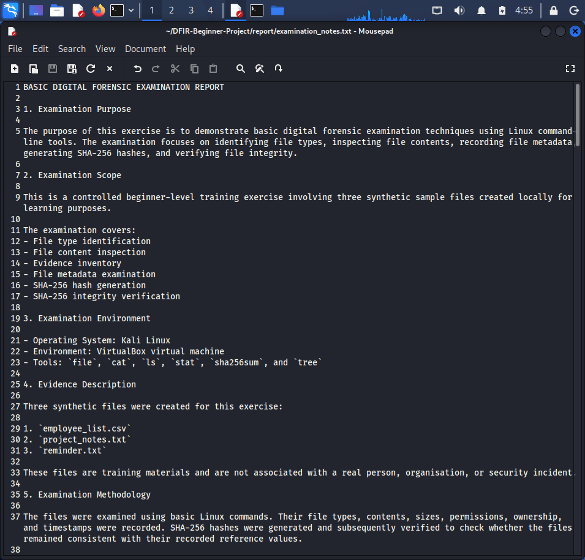
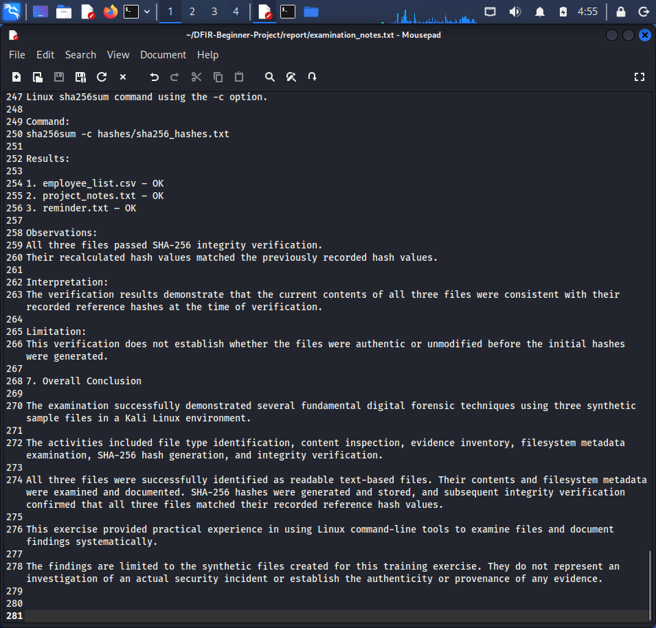

# Basic Digital Forensic Examination

A beginner-level digital forensics project demonstrating fundamental evidence examination, file integrity verification and forensic documentation using Kali Linux.

## Project Overview

This project documents a practical digital forensic examination conducted in a Kali Linux virtual machine.

The exercise uses three self-created synthetic sample files to practise fundamental forensic procedures, including file identification, content inspection, evidence inventory, SHA-256 hashing, hash verification and filesystem metadata examination.

**Project Type:** Practical Digital Forensics Lab  
**Environment:** Kali Linux (VirtualBox)  
**Operating System:** Linux  
**Tools:** `file`, `cat`, `ls`, `sha256sum`, `stat`, `tree`

## Objectives

- Identify file types using the Linux `file` command.
- Inspect and document sample file contents.
- Create SHA-256 hashes for evidence files.
- Verify file integrity against previously recorded hashes.
- Examine filesystem metadata, permissions and timestamps.
- Document examination procedures, observations and limitations.

## Evidence Description

Three synthetic sample files were created specifically for this exercise.

| Evidence File | Description | Size |
|---|---|---:|
| `employee_list.csv` | Sample employee records | 80 bytes |
| `project_notes.txt` | Sample project documentation | 92 bytes |
| `reminder.txt` | Sample investigation-related reminders | 114 bytes |

**Total evidence size:** 286 bytes.

These files do not originate from an actual investigation and contain no real personal data.

## Examination Activities

### 1. File Type Identification
Used the Linux `file` command to identify the formats of the sample files.

### 2. Content Inspection
Used the `cat` command to inspect and document the contents of each sample file.

### 3. Evidence Inventory
Used `ls -lh` to record filenames, file sizes, ownership and permissions.

### 4. SHA-256 Hash Generation
Generated SHA-256 hashes for all three sample files and saved the results in a hash record.

### 5. Hash Verification
Used `sha256sum -c` to compare the current file contents against the previously recorded hashes.

All three files returned an `OK` verification result.

### 6. Filesystem Metadata Examination
Used the Linux `stat` command to examine:

- File sizes and file types
- File permissions and ownership
- Inode numbers
- Access timestamps
- Modification timestamps
- Metadata change timestamps
- Birth timestamps, where available

## Project Structure

```text
DFIR-Beginner-Project/
├── evidence/
│   ├── employee_list.csv
│   ├── project_notes.txt
│   └── reminder.txt
├── hashes/
│   └── sha256_hashes.txt
├── report/
│   └── examination_notes.txt
├── screenshots/
│   ├── 01-file-type-identification.png
│   ├── 02-sha256-hash-generation.png
│   ├── 03-sha256-integrity-verification.png
│   ├── 04-file-metadata-examination.png
│   ├── 05-report-introduction.png
│   └── 06-report-conclusion.png
└── README.md
```

## Screenshots

The following screenshots document the examination process and report preparation.

### 1. File Type Identification


### 2. SHA-256 Hash Generation


### 3. SHA-256 Integrity Verification


### 4. Filesystem Metadata Examination


### 5. Examination Report – Introduction


### 6. Examination Report – Conclusion


## Tools and Commands

| Tool / Command | Purpose |
|---|---|
| `file` | File type identification |
| `cat` | Content inspection |
| `ls` | Evidence inventory |
| `sha256sum` | Hash generation and verification |
| `stat` | Filesystem metadata examination |
| `tree` | Directory structure inspection |

## Limitations

- The sample files are synthetic and do not represent real-world evidence.
- Hash verification confirms consistency with the recorded hashes, not authenticity before initial hashing.
- Filesystem timestamps may be affected by file operations and system clock settings.
- File contents alone cannot establish authorship or the truth of the information recorded.
- This exercise does not involve disk imaging, deleted-file recovery or a full forensic investigation.

## Learning Outcomes

Through this exercise, I gained practical experience with fundamental digital forensic examination procedures, SHA-256 integrity verification, filesystem metadata inspection and forensic documentation using Linux command-line tools.

This project serves as an initial practical exercise in developing my digital forensics and incident response skills.

## Disclaimer

This project was created for educational and portfolio purposes. It uses self-created synthetic sample files and does not contain real personal data or evidence from an actual investigation.
